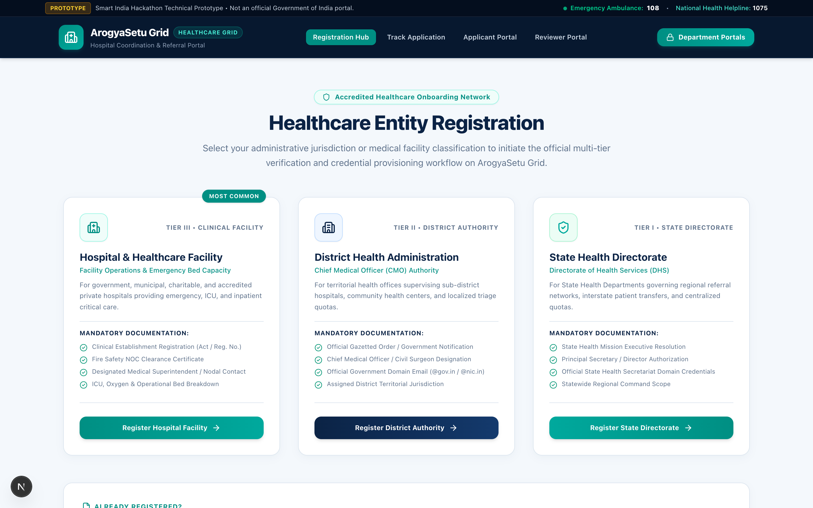
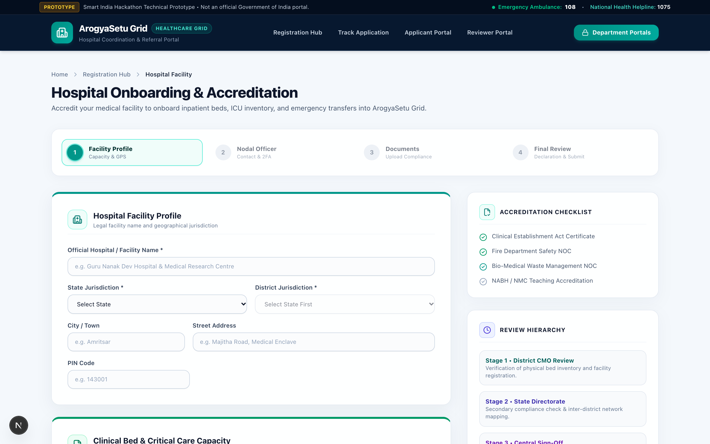
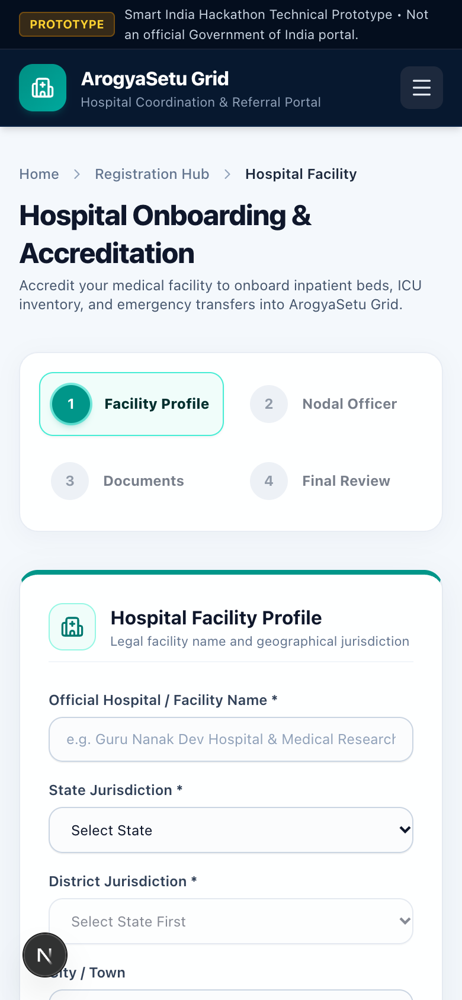
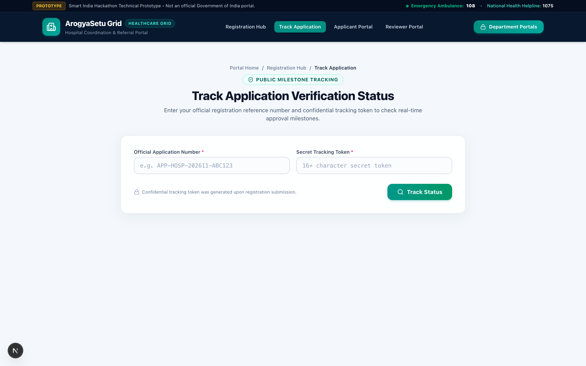
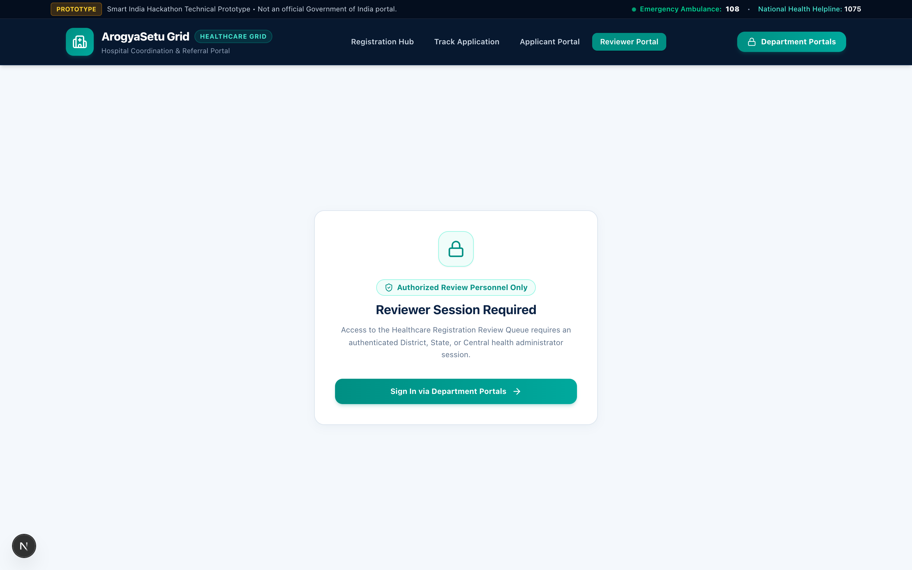
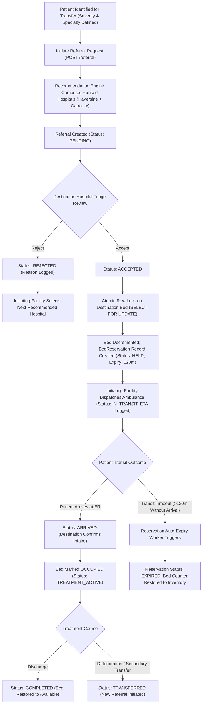
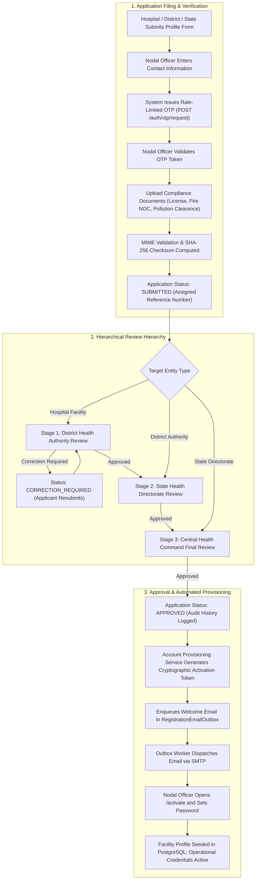
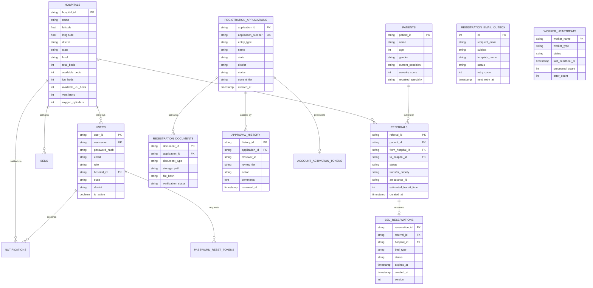

# 🏥 SIH Hospital AI — Intelligent Hospital Referral and Bed Management System

> **A Multi-Tier Healthcare Logistics, Bed Inventory Allocation, and Inter-Hospital Referral Coordination Platform**  
> *Developed as an Engineering Prototype & Technical Reference Architecture under the Smart India Hackathon (SIH) framework.*

[](https://www.python.org/)
[](https://fastapi.tiangolo.com/)
[](https://nextjs.org/)
[](https://react.dev/)
[](https://www.typescriptlang.org/)
[](https://tailwindcss.com/)
[](https://www.postgresql.org/)
[](https://www.sqlalchemy.org/)
[](https://redis.io/)
[](https://scikit-learn.org/)
[](https://playwright.dev/)
[](https://www.docker.com/)

---

## 📖 Table of Contents

1. [Project Overview](#1-project-overview)
2. [Interface Screenshots](#2-interface-screenshots)
3. [Key Features](#3-key-features)
4. [System Architecture](#4-system-architecture)
5. [Core Workflows](#5-core-workflows)
   - [5.1 Patient Referral Lifecycle & Bed Reservation](#51-patient-referral-lifecycle--bed-reservation)
   - [5.2 Multi-Tier Registration & Regulatory Approval](#52-multi-tier-registration--regulatory-approval)
6. [Technology Stack](#6-technology-stack)
7. [Database Architecture & Entity Relationships](#7-database-architecture--entity-relationships)
8. [Project Directory Structure](#8-project-directory-structure)
9. [Installation & Local Setup](#9-installation--local-setup)
10. [Environment Configuration](#10-environment-configuration)
11. [API Documentation](#11-api-documentation)
12. [Testing & Quality Verification](#12-testing--quality-verification)
13. [Production Deployment](#13-production-deployment)
14. [Security & Data Governance](#14-security--data-governance)
15. [Current Limitations & Future Scope](#15-current-limitations--future-scope)
16. [Contributors & License](#16-contributors--license)

---

## 1. Project Overview

### The Challenge in Emergency Healthcare Coordination
In multi-tier public health ecosystems, acute medical emergencies and ICU bed allocation face severe friction:
- **Critical Care Bottlenecks:** Patients experiencing acute conditions (severe trauma, cardiac arrest, respiratory failure) are often routed to facilities without confirmed bed, ventilator, or specialized clinical capacity.
- **Ambulance Diversions:** Uncoordinated transfers result in ambulances traveling between overloaded hospitals, losing precious minutes during the "Golden Hour."
- **Informal Communication Channels:** Referrals are frequently coordinated over unlogged phone calls or informal messaging without real-time reservation guarantees, leading to bed hoarding and phantom availability.
- **Accreditation Delays:** Frontline facilities face weeks of manual paperwork when seeking administrative onboarding, license verification, and inclusion into regional referral grids.

### How SIH Hospital AI Solves This
**SIH Hospital AI** is a distributed, full-stack clinical coordination and capacity surveillance platform designed to bridge community health centers, district hospitals, medical colleges, and state health directorates into an integrated digital network:
1. **Dynamic Eligibility Gating & Hybrid Ranking:** Analyzes patient acuity, required clinical specialties, ICU/ventilator capacity, and Haversine geo-distance to recommend the most optimal receiving hospitals.
2. **Atomic Bed Reservation with Expiry Windows:** Secures an ICU or general bed immediately upon referral acceptance, preventing race conditions via PostgreSQL row-level locks (`SELECT FOR UPDATE`), with automated background expiry to prevent artificial capacity locking.
3. **Four-Tier Jurisdictional Governance:** Implements distinct operational portals and dashboards for **Facility Staff**, **District Health Officers**, **State Health Directorates**, and **Central Health Command**.
4. **Hierarchical Onboarding & Auditability:** Structured multi-tier regulatory onboarding pipeline with nodal officer two-factor OTP verification, document upload validation, sequential jurisdictional sign-offs, and automated credential provisioning.
5. **Operational Telemetry & Worker Reliability:** Prometheus-compatible application metrics, PostgreSQL connection pool telemetry, worker heartbeat tracking, and transactional outbox email delivery.

> [!NOTE]
> **Academic & Technical Prototype Notice:**  
> SIH Hospital AI is an independent engineering prototype and technical reference architecture developed under Smart India Hackathon guidelines. It is not an officially operated Government of India service, does not process live Protected Health Information (PHI), and does not provide public telecom emergency dispatch services. Emergency contact numbers (`108` and `1075`) referenced in the interface are standard Indian public telephone helplines provided for contextual realism.

---

## 2. Interface Screenshots

The frontend has been built with Next.js 16, React 19, and Tailwind CSS v4, adhering to an official, accessible government portal aesthetic. All screenshots below are genuine captures archived in [`frontend/public/screenshots/`](frontend/public/screenshots/).

### 2.1 Public Landing Page
The public landing page provides citizens and healthcare providers with platform information, administrative access tiers, accreditation pipeline overviews, and capacity surveillance indicators without exposing clinical data.

| Desktop View (1280px) | Mobile View (Pixel 7) |
| :---: | :---: |
|  |  |
| *National Hospital Management & Coordination Portal — Desktop Overview* | *Responsive Navigation Drawer & Clean Mobile Hero* |

---

### 2.2 Department Selection Gateway
The `/portal` gateway presents the 4 administrative healthcare access tiers, enabling users to enter their authorized operational portal.

| Desktop View (1280px) | Mobile View (Pixel 7) |
| :---: | :---: |
|  |  |
| *Four-Tier Department Gateway (Facility, District, State, Central)* | *Responsive Tier Selection on Mobile* |

---

### 2.3 Dedicated Department Login Portals
Each administrative tier features an isolated login experience with strict **Role-Mismatch Protection** to prevent cross-tier credential abuse.

| Facility Tier (`/portal/hospital/login`) | District Tier (`/portal/district/login`) |
| :---: | :---: |
|  |  |
| *Hospital Operations Login (Beds, ICU, Referral Intake)* | *District Health Authority Login (Accreditation Stage 1)* |

| State Tier (`/portal/state/login`) | National Tier (`/portal/central/login`) |
| :---: | :---: |
|  |  |
| *State Health Directorate Login (Accreditation Stage 2)* | *Central Health Command Login (National Oversight & Final Stage 3)* |

---

### 2.4 Active Role-Mismatch Interceptor
When a user attempts to authenticate to an incorrect department portal (e.g., entering `DISTRICT_ADMIN` credentials on the Hospital Portal), the client-side authentication interceptor immediately invalidates the session token, blocks unauthorized dashboard access, and displays a contextual redirection alert.

<p align="center">
  
  <br>
  <em>Active Role-Mismatch Guard — Intercepts Cross-Tier Login & Directs to Authorized Portal</em>
</p>

---

### 2.5 Healthcare Entity Registration Hub
The `/register` portal allows hospitals, district health administrations, and state directorates to initiate the official accreditation workflow.

<p align="center">
  
  <br>
  <em>Multi-Tier Healthcare Entity Registration Hub (Facility, District, and State Directorates)</em>
</p>

---

### 2.6 Multi-Step Facility Onboarding Form (Desktop & Mobile)
Accreditation onboarding features a 4-step stepper with real-time pre-submission verification checklists and full mobile responsiveness.

| Desktop Stepper View (1440px) | Mobile Responsive View (390px) |
| :---: | :---: |
|  |  |
| *Hospital Facility Profile & Nodal Verification Stepper* | *Mobile Responsive Form Layout & Navigation Drawer* |

---

### 2.7 Application Milestone Tracking & Reviewer Command Center
Applicants track real-time verification milestones using secret tokens, while authorized health reviewers manage the accreditation queue.

| Public Milestone Tracker (`/application/track`) | Reviewer Command Queue (`/reviewer`) |
| :---: | :---: |
|  |  |
| *Public Milestone Verification Status Tracker* | *Reviewer Command Center & Role Gatekeeper* |

---

## 3. Key Features

### 🏥 Hospital Bed & Resource Inventory Management
- **Atomic Bed Accounting:** Manages General, Oxygen-Supported, ICU, and Ventilator bed allocations using explicit SQL counter synchronizations (`migrations/004_category_occupancy_counters.sql`).
- **Inventory Updates:** Real-time endpoints (`PUT /hospitals/{id}/inventory` and `PATCH /hospitals/{id}/resources`) allowing hospital ward in-charges to update bed states with transactional consistency.
- **Threshold Alerting:** Triggers automatic operational notifications whenever ICU beds fall $\le 1$ or General beds fall $\le 2$.

### 🚑 Intelligent Patient Referral & Recommendation Engine
- **Two-Stage Hybrid Recommendation Algorithm:**
  - **Stage A (Deterministic Gating):** Filters out facilities lacking the required medical specialty, operating below minimum bed thresholds, or located outside feasible geographic bounds.
  - **Stage B (Heuristic & ML Ranking):** Ranks candidate hospitals using Haversine distance, available bed ratios, specialized equipment availability, and historical acceptance weights (`src/prediction/ranking_engine.py`).
  - **Tiered Fallback Mechanism:** Gracefully expands search radius: *Same District $\rightarrow$ Adjacent District $\rightarrow$ State Tertiary Centers $\rightarrow$ Apex National Institutes*.
- **Full Referral Lifecycle:** Enforces state machine transitions: `PENDING` $\rightarrow$ `ACCEPTED` / `REJECTED` $\rightarrow$ `IN_TRANSIT` $\rightarrow$ `ARRIVED` $\rightarrow$ `TREATMENT_ACTIVE` $\rightarrow$ `COMPLETED` / `TRANSFERRED` / `DIED`.
- **Ambulance Tracking Metadata:** Records ambulance identifiers, estimated transit times (ETA), and dispatch timestamps.

### 🔒 Atomic Bed Reservation & Automatic Expiry
- **Race Condition Prevention:** When a destination hospital accepts a referral, the bed reservation service executes a row-level lock (`SELECT ... FOR UPDATE`) on the target hospital inventory record.
- **Timed Bed Holds:** Allocates a temporary reservation hold (default: 120 minutes) to keep the bed reserved while the ambulance is in transit.
- **Asynchronous Auto-Expiry Worker:** Dedicated background worker (`src/workers/reservation_expiry_worker.py`) polls every 30 seconds to automatically release expired reservations, restore bed counts, and mark referrals as `EXPIRED` if the patient fails to arrive.

### 🏛️ Multi-Tier Hospital Registration & Approval System
- **Four-Stage Registration Pipeline:**
  1. *Profile & Capacity:* Bed counts, ICU beds, oxygen inventory, geo-coordinates, and operational licenses.
  2. *Nodal Officer 2FA:* Rate-limited OTP verification via email/SMS.
  3. *Document Audit:* Upload and storage of clinical establishment licenses, fire safety NOCs, and pollution certificates with SHA-256 hash checks and MIME-type validation.
  4. *Hierarchical Review:* Sequential multi-tier review pipeline: *District $\rightarrow$ State $\rightarrow$ Central*.
- **Reviewer Dossier View:** Government administrators can inspect hospital applications, preview uploaded documents, verify compliance checklists, and execute `APPROVE`, `REJECT`, or `REQUEST_CORRECTION` actions.
- **Account Provisioning:** Upon Central approval, automated provisioning generates cryptographically secure activation tokens, delivers onboarding emails via the outbox worker, and provisions facility logins.

### 📡 Observability, Telemetry & Operations
- **Prometheus-Style Metrics:** Custom `/metrics` endpoint surfacing HTTP request latencies, error counts, active database pool connections, and queue depths.
- **Health Probes:** Kubernetes-ready `/health`, `/health/live`, and `/health/ready` endpoints verifying database connectivity, Redis responsiveness, and worker heartbeat freshness.
- **Worker Heartbeat Tracking:** Background workers register heartbeats in PostgreSQL (`WorkerHeartbeat` table) with configurable stale-state detection (`src/services/alerting_service.py`).
- **Transactional Outbox Engine:** Relies on the Transactional Outbox pattern (`RegistrationEmailOutbox`) to decouple database transactions from external SMTP delivery, ensuring zero email loss during network timeouts.

---

## 4. System Architecture

The following diagram illustrates the component architecture, data flows, and external integrations implemented in SIH Hospital AI:

```mermaid
graph TD
    subgraph ClientTier["Client Tier (Frontend - Next.js 16 / React 19)"]
        UI_Public["Public Landing Page (/)"]
        UI_Portal["Department Gateway (/portal)"]
        UI_Login["Department Login Portals (/portal/*/login)"]
        UI_Dashboards["Role Dashboards (Hospital, District, State, Central)"]
        UI_Reviewer["Accreditation Reviewer Portal (/reviewer)"]
        UI_Monitor["Admin Telemetry Dashboard (/admin/monitoring)"]
    end

    subgraph GatewayTier["API Gateway & Middleware Layer"]
        CORS["CORS Middleware (Allowed FQDNs)"]
        RateLimiter["Distributed Rate Limiter (Redis / Sliding Window)"]
        JWTAuth["JWT Authentication & RBAC Enforcer"]
    end

    subgraph BackendCore["FastAPI Backend Application Core (Uvicorn)"]
        API_Obs["Observability API (/health, /metrics)"]
        API_Reg["Registration API (/api/registration)"]
        API_Ref["Referral & Bed API (/referrals, /hospitals)"]
        API_Admin["Administrative Hierarchy API (/admin/*)"]
        
        Service_Reg["Registration Service & Document Storage"]
        Service_Alert["Alert Engine & Threshold Evaluator"]
        Service_Outbox["Email Outbox Service"]
        Service_Ranking["Hybrid Recommendation & Ranking Engine"]
        Service_BedLock["Atomic Bed Reservation (Row-Locking)"]
    end

    subgraph DataStorageTier["Persistence & Caching Tier"]
        PG[(PostgreSQL 15+ Primary DB)]
        subgraph Tables["Relational Tables"]
            T_Hosp["Hospitals & Bed Inventory"]
            T_Ref["Referrals & Bed Reservations"]
            T_App["Registration Applications & Documents"]
            T_Outbox["Registration Email Outbox"]
            T_Heartbeat["Worker Heartbeats"]
            T_Audit["Audit Logs & Notifications"]
        end
        RedisCache[(Redis 8 Cache / Token Revocation)]
        DocStorage[("Secure Document Storage (Filesystem / Volume)")]
    end

    subgraph BackgroundWorkers["Autonomous Background Workers"]
        Worker_Outbox["Transactional Outbox Worker (src.workers.outbox_worker)"]
        Worker_Expiry["Reservation Auto-Expiry Worker (src.workers.reservation_expiry_worker)"]
    end

    subgraph ExternalIntegrations["External Services & Transport"]
        BrevoSMTP["Brevo SMTP Relay (smtp-relay.brevo.com)"]
        EmailRecipients["Nodal Officers & Healthcare Staff (Email Delivery)"]
    end

    %% Client to Gateway
    UI_Public --> CORS
    UI_Portal --> CORS
    UI_Login --> CORS
    UI_Dashboards --> CORS
    UI_Reviewer --> CORS
    UI_Monitor --> CORS

    CORS --> RateLimiter
    RateLimiter --> JWTAuth

    %% Gateway to API Endpoints
    JWTAuth --> API_Obs
    JWTAuth --> API_Reg
    JWTAuth --> API_Ref
    JWTAuth --> API_Admin

    %% APIs to Core Services
    API_Obs --> Service_Alert
    API_Reg --> Service_Reg
    API_Reg --> Service_Outbox
    API_Ref --> Service_Ranking
    API_Ref --> Service_BedLock
    API_Admin --> Service_Reg

    %% Services to Data Storage
    Service_Reg --> PG
    Service_Reg --> DocStorage
    Service_Alert --> PG
    Service_Outbox --> PG
    Service_Ranking --> PG
    Service_BedLock --> PG
    RateLimiter --> RedisCache

    %% Background Workers to Storage & External
    Worker_Outbox --> PG
    Worker_Outbox --> BrevoSMTP
    BrevoSMTP --> EmailRecipients
    Worker_Expiry --> PG
    Worker_Outbox -.->|Heartbeat| T_Heartbeat
    Worker_Expiry -.->|Heartbeat| T_Heartbeat
```



---

## 5. Core Workflows

### 5.1 Patient Referral Lifecycle & Bed Reservation
When an inpatient requires critical care transfer, the initiating hospital uses the referral triage system. The diagram below details the end-to-end clinical workflow:



---

### 5.2 Multi-Tier Registration & Regulatory Approval
Healthcare facilities and administrative bodies must complete a verified hierarchical onboarding process before receiving production platform credentials:



---

## 6. Technology Stack

All technologies and version numbers listed below have been verified directly against project dependency files (`requirements.txt`, `frontend/package.json`, and Docker configurations):

| Layer / Subsystem | Technology | Verified Version | Purpose & Application |
| :--- | :--- | :--- | :--- |
| **Backend Framework** | **FastAPI** | `0.141.1` | Asynchronous REST API, dependency injection, OpenAPI documentation. |
| **ASGI Server** | **Uvicorn** / **uvloop** | `0.52.3` / `0.22.1` | High-throughput asynchronous HTTP application server. |
| **Database ORM** | **SQLAlchemy** | `2.0.52` | Declarative models, connection pooling, and atomic transactional operations. |
| **Data Validation** | **Pydantic** | `2.13.4` | Request schema parsing, environment configuration, type validation. |
| **Relational Database** | **PostgreSQL** | `15+` (Driver: `psycopg2-binary 2.9.13`) | Primary transactional persistence, row-level locks, foreign-key constraints. |
| **Caching & Rate Limiting** | **Redis** | `8.1.0` (Testing: `fakeredis 2.40.0`) | Distributed token revocation, sliding-window rate limiting. |
| **AI / Machine Learning** | **scikit-learn** / **NumPy** / **Pandas** | `1.9.0` / `2.5.2` / `3.0.5` | Hospital ranking, feature extraction, capability score calculation. |
| **Security & Auth** | **PyJWT** / **Passlib** | `2.13.0` / `1.7.4` | JWT bearer token issuance, timing-safe PBKDF2 password hashing. |
| **Frontend Framework** | **Next.js** (App Router) | `16.3.0` | React server/client components, route handling, standalone compilation. |
| **UI Library** | **React** / **React DOM** | `19.2.8` | Component rendering, hooks, interactive dashboard interfaces. |
| **Styling & Design** | **Tailwind CSS** | `v4` | Modern utility-first responsive styling and government UI design. |
| **Icons & Typography** | **Lucide React** | `^1.73.0` | Accessible official healthcare and administrative iconography. |
| **End-to-End Testing** | **Playwright** | `1.65.0` | Cross-browser integration testing (Chromium Desktop & Mobile Pixel 7). |
| **Backend Testing** | **pytest** / **pytest-asyncio** | `9.1.1` | Unit testing, database fixture isolation, regression test suites. |
| **Static Analysis** | **ESLint** / **TypeScript** | `v9` / `v5` | Code quality enforcement, type safety across frontend codebase. |
| **Containerization** | **Docker** / **Docker Compose** | Multi-stage builds | Production containerization (`Dockerfile.backend`, `Dockerfile.frontend`). |

---

## 7. Database Architecture & Entity Relationships

The relational schema is managed through versioned SQL migrations in `migrations/` (`001_initial_postgresql_schema.sql` through `006_workflow_notifications.sql`). The core entity relationships are modeled below:



---

## 8. Project Directory Structure

```text
SIH_Hospital_AI/
├── .github/                            # GitHub configuration and templates
├── data/                               # Local SQLite development files & test data
│   └── storage/documents/              # Uploaded verification documents (isolated)
├── docker/                             # Docker startup & database initialization
│   └── initdb/01_run_migrations.sh     # Auto-migration script for container startup
├── docs/                               # Comprehensive Technical & Operations Documentation
│   ├── architecture.md                 # System architecture, engines, state machines & diagrams
│   ├── installation.md                 # Step-by-step developer onboarding & local setup
│   ├── database.md                     # PostgreSQL schemas, migrations, pools & recovery
│   ├── deployment.md                   # Cloud (Render + Vercel) and Docker Compose deployment
│   ├── security.md                     # RBAC, cryptography, tokens & security checklist
│   ├── worker_operations.md            # Background worker architecture & daemons
│   ├── smtp_setup.md                   # Brevo & external SMTP email relay configuration
│   ├── data_dictionary.md              # Field definitions for hospitals & referrals
│   └── medical_assumptions.md          # Clinical assumptions & specialty groupings
├── frontend/                           # Next.js 16 Web Application
│   ├── app/                            # Next.js App Router routes
│   │   ├── activate/                   # Account activation & credential creation
│   │   ├── application/track/          # Public application status lookup
│   │   ├── forgot-password/            # Password recovery request workflow
│   │   ├── portal/                     # Department gateway & dedicated logins
│   │   │   ├── central/login/          # National Tier login portal
│   │   │   ├── district/login/         # District Tier login portal
│   │   │   ├── hospital/login/         # Facility Tier login portal
│   │   │   └── state/login/            # State Tier login portal
│   │   ├── register/                   # Multi-tier registration filing pages
│   │   ├── reset-password/             # Tokenized password reset page
│   │   ├── reviewer/                   # Accreditation dossier review & decision view
│   │   ├── layout.tsx                  # Root layout with government portal metadata
│   │   └── page.tsx                    # Public Government Healthcare Landing Page
│   ├── components/                     # Reusable React components
│   │   ├── auth/DepartmentLoginPage.tsx# Department login template with Role-Mismatch guard
│   │   ├── registration/               # Registration form steps & document uploader
│   │   ├── reviewer/                   # Reviewer dashboard, inbox & dossier inspector
│   │   ├── shared/                     # GovernmentHeader, GovernmentFooter, Modals
│   │   ├── CentralDashboard.tsx        # National-level monitoring view
│   │   ├── DistrictDashboard.tsx       # District-level hospital oversight view
│   │   ├── HospitalDashboard.tsx       # Bed management & patient triage view
│   │   └── StateDashboard.tsx          # State-level healthcare administration view
│   ├── e2e/                            # Playwright end-to-end browser test suites
│   │   ├── capture_screenshots.spec.ts # Automated screenshot capture suite
│   │   ├── phase2d_browser_workflows.spec.ts # 20 complete browser E2E workflows
│   │   └── portal_navigation_and_departments.spec.ts # 12 portal navigation tests
│   ├── lib/                            # API client, types, and jurisdictional helpers
│   ├── public/screenshots/             # Archived high-resolution visual captures
│   ├── package.json                    # Frontend dependencies & build scripts
│   └── playwright.config.ts            # Playwright browser testing configuration
├── migrations/                         # Versioned PostgreSQL SQL migrations
│   ├── 001_initial_postgresql_schema.sql
│   ├── 002_referral_workflow_and_notifications.sql
│   ├── 003_registration_system.sql
│   ├── 004_category_occupancy_counters.sql
│   ├── 005_worker_heartbeats.sql
│   └── 006_workflow_notifications.sql
├── scripts/                            # Operational utility & diagnostic scripts
│   ├── backup_database.sh              # Database custom-format backup script
│   ├── restore_database.sh             # Validated database restoration script
│   ├── send_test_email.py              # Operator test email dispatch tool
│   └── smtp_health_check.py            # Brevo SMTP diagnostic health check
├── src/                                # Backend Application Source Code (FastAPI)
│   ├── api/                            # REST API endpoints & route declarations
│   │   ├── admin_routes.py             # Administrative endpoints (District, State, Central)
│   │   ├── main.py                     # Primary FastAPI application entry point
│   │   ├── observability.py            # Health probes, metrics, and alerting engine
│   │   ├── registration_routes.py      # Registration, review & verification routes
│   │   └── schemas.py                  # Pydantic request and response schemas
│   ├── auth/                           # Authentication & authorization services
│   │   ├── auth_store.py               # Password hashing & user validation
│   │   ├── authorization.py            # Role-Based Access Control (RBAC) checks
│   │   ├── jwt_utils.py                # JWT creation, decoding, and signing
│   │   └── rate_limiter.py             # Redis sliding-window distributed rate limiter
│   ├── database/                       # Database models & repository layer
│   │   ├── db_manager.py               # SQLAlchemy engine & session factory
│   │   ├── pg_models.py                # PostgreSQL ORM entity declarations
│   │   └── pg_repository.py            # Data access object (DAO) repository layer
│   ├── prediction/                     # AI/ML & recommendation algorithms
│   │   ├── bed_reservation.py          # Atomic row-lock bed reservation logic
│   │   ├── ranking_engine.py           # Hybrid heuristic & machine learning ranking
│   │   └── recommendation.py           # Eligibility gating & distance calculation
│   ├── services/                       # Core domain business logic services
│   │   ├── account_provisioning_service.py # Automated credential provisioning
│   │   ├── alerting_service.py         # SLA & threshold alert engine
│   │   ├── document_storage.py         # Document upload, hash verification, storage
│   │   ├── email_outbox_service.py     # Transactional outbox pattern manager
│   │   ├── email_service.py            # Brevo SMTP & simulated email transport
│   │   ├── otp_service.py              # Two-factor verification token service
│   │   ├── registration_service.py     # Multi-tier registration business logic
│   │   └── workflow_notification_service.py # In-app operational notifications
│   ├── workers/                        # Background processing daemons
│   │   ├── outbox_worker.py            # Asynchronous email delivery worker
│   │   └── reservation_expiry_worker.py# Automatic bed reservation expiry worker
│   └── config.py                       # Application configuration & environment loader
├── tests/                              # Comprehensive backend test suite (pytest)
│   ├── test_document_storage_and_provisioning.py
│   ├── test_email_delivery_and_smtp.py
│   ├── test_operational_inventory.py
│   ├── test_operational_notifications.py
│   ├── test_outbox_worker_reliability.py
│   ├── test_phase2d_reviewer_and_lifecycle.py
│   ├── test_phase4d4_monitoring.py
│   ├── test_registration_api.py
│   ├── test_reservation_expiry_worker.py
│   └── test_referral_and_bed_lifecycle.py
├── .dockerignore                       # Docker build exclusion rules
├── .env.example                        # Development environment template
├── .env.production.example             # Production environment template
├── Dockerfile.backend                  # Production multi-stage backend container
├── Dockerfile.frontend                 # Production standalone Next.js container
├── docker-compose.prod.yml             # Production multi-service orchestration
├── e2e_db_helper.py                    # Isolated test database helper for E2E tests
├── requirements.txt                    # Python backend dependencies
└── verify_phase2d_backend_workflows.py # Phase 2D standalone workflow validator
```

---

## 9. Installation & Local Setup

### 9.1 Prerequisites
Ensure your local environment meets the following minimum requirements:
- **Python:** `3.11+` (tested and verified on `3.14.3`)
- **Node.js:** `18.18+` or `20.x` (tested on `v20.x`) and `npm`
- **PostgreSQL:** `15+` installed and running locally
- **Redis:** `7+` (optional for local development; system gracefully falls back to in-memory rate limiting when Redis is absent)
- **Git:** Standard CLI

---

### 9.2 Step-by-Step Setup Instructions

#### Step 1: Clone the Repository
```bash
git clone https://github.com/codeswith-pawan/SIH-Hospital-AI.git
cd SIH-Hospital-AI
```

#### Step 2: Configure Backend Virtual Environment & Dependencies
```bash
# Create and activate Python virtual environment
python3 -m venv .venv
source .venv/bin/activate

# Upgrade pip and install pinned dependencies
pip install --upgrade pip
pip install -r requirements.txt
```

#### Step 3: Configure Environment Variables
```bash
# Create local development environment file from template
cp .env.example .env

# Create frontend environment file from template
cp frontend/.env.example frontend/.env.local
```

#### Step 4: Configure PostgreSQL Database & Run Migrations
Create a local PostgreSQL database for development:
```bash
# Create database in PostgreSQL
createdb sih_hospital_dev

# Execute versioned migrations in sequence
psql -d sih_hospital_dev -f migrations/001_initial_postgresql_schema.sql
psql -d sih_hospital_dev -f migrations/002_referral_workflow_and_notifications.sql
psql -d sih_hospital_dev -f migrations/003_registration_system.sql
psql -d sih_hospital_dev -f migrations/004_category_occupancy_counters.sql
psql -d sih_hospital_dev -f migrations/005_worker_heartbeats.sql
psql -d sih_hospital_dev -f migrations/006_workflow_notifications.sql
```
*(Ensure `DATABASE_URL` in your `.env` matches your local database credentials: `postgresql://localhost:5432/sih_hospital_dev`)*.

#### Step 5: Install Frontend Dependencies
```bash
cd frontend
npm install
cd ..
```

---

### 9.3 Launching the Platform

To run the complete platform locally, execute each process in a separate terminal:

#### 1. Start the FastAPI Backend
```bash
source .venv/bin/activate
uvicorn src.api.main:app --host 127.0.0.1 --port 8000 --reload
```
*Backend API will be accessible at: `http://127.0.0.1:8000`*

#### 2. Start the Next.js Frontend
```bash
cd frontend
npm run dev
```
*Frontend application will be accessible at: `http://localhost:3000`*

#### 3. Start Background Workers (Optional for Full Feature Simulation)
```bash
# Terminal 3: Start the Transactional Email Outbox Worker
source .venv/bin/activate
python -m src.workers.outbox_worker

# Terminal 4: Start the Bed Reservation Auto-Expiry Worker
source .venv/bin/activate
python -m src.workers.reservation_expiry_worker
```

---

## 10. Environment Configuration

All application configurations are managed using Pydantic Settings (`src/config.py`). Sanitize and populate variables using `.env.example`:

| Environment Variable | Default (Dev) | Production Invariant | Purpose |
| :--- | :--- | :--- | :--- |
| `ENVIRONMENT` | `development` | `production` | Enforces production startup validation checks. |
| `HOST` / `PORT` | `0.0.0.0` / `8000` | `0.0.0.0` / `8000` | Application server binding address. |
| `DATABASE_URL` | `postgresql://...` | `postgresql://...` | PostgreSQL connection string (PostgreSQL required in prod). |
| `DB_POOL_SIZE` | `10` | `20` | SQLAlchemy connection pool size. |
| `DB_MAX_OVERFLOW` | `20` | `10` | Maximum connection overflow above pool size. |
| `REDIS_URL` | `redis://127.0.0.1:6379/0` | `redis://...` | Redis server address for distributed rate limiting. |
| `REDIS_REQUIRED` | `false` | `true` | When true, server halts if Redis is unreachable. |
| `JWT_SECRET_KEY` | *(demo string)* | `[min 32 chars random]` | Cryptographic key for signing JWT tokens. |
| `JWT_ALGORITHM` | `HS256` | `HS256` | Token signing algorithm. |
| `SIH_EMAIL_BACKEND` | `simulated` | `smtp` | Email transport (`simulated` logs to console; `smtp` uses Brevo). |
| `SIH_OTP_PROVIDER` | `SIMULATED` | `EMAIL` | OTP generation mode (`SIMULATED` returns `123456`). |
| `SMTP_HOST` | `smtp-relay.brevo.com` | `smtp-relay.brevo.com` | External SMTP server host. |
| `SMTP_PORT` | `587` | `587` | External SMTP submission port (STARTTLS). |
| `SMTP_USERNAME` | *(placeholder)* | `[Brevo Login Email]` | SMTP authentication account. |
| `SMTP_PASSWORD` | *(placeholder)* | `[Brevo SMTP Key]` | SMTP authentication password/key. |
| `SMTP_FROM_EMAIL` | `no-reply@...` | `[Verified Sender]` | Envelope sender address for outbound emails. |
| `STORAGE_BASE_DIR` | `/tmp/sih_documents` | `/var/lib/...` | Filesystem path for encrypted document storage. |
| `CORS_ORIGINS` | `http://localhost:3000` | `https://hospital...` | Comma-separated list of allowed origins (no wildcards). |

---

## 11. API Documentation

FastAPI automatically generates interactive OpenAPI documentation from Pydantic schemas. With the backend running:

- **Interactive Swagger UI:** [`http://127.0.0.1:8000/docs`](http://127.0.0.1:8000/docs)  
  *Allows developers and evaluators to execute API requests, inspect schemas, and test JWT authentication.*
- **ReDoc Documentation:** [`http://127.0.0.1:8000/redoc`](http://127.0.0.1:8000/redoc)  
  *Clean, searchable reference layout for all endpoint specifications.*
- **OpenAPI JSON Schema:** [`http://127.0.0.1:8000/openapi.json`](http://127.0.0.1:8000/openapi.json)  
  *Raw OpenAPI 3.1.0 specification for automated SDK or client generation.*

---

## 12. Testing & Quality Verification

The repository enforces strict test automation across backend services, database transactions, and frontend browser journeys.

### 12.1 Backend Pytest Suite
The backend test suite covers atomic bed locking, inventory consistency, registration workflows, email delivery, observability metrics, and worker reliability:
```bash
# Run complete backend suite against isolated test database
source .venv/bin/activate
pytest -q
```
**Verified Backend Execution Result (November 2026):**
```text
414 passed, 413 warnings in 35.05s (Exit Code: 0)
```

---

### 12.2 Frontend Quality Gates & Playwright E2E Suite
Frontend code quality and user journeys are validated using TypeScript, ESLint, Next.js build compilation, and headless Playwright browser tests:

```bash
cd frontend

# 1. TypeScript compilation check
npx tsc --noEmit

# 2. ESLint static analysis
npm run lint

# 3. Next.js standalone production build
npm run build

# 4. Portal navigation & Department journey E2E tests
npx playwright test e2e/portal_navigation_and_departments.spec.ts

# 5. Phase 2D complete browser workflow tests
npx playwright test e2e/phase2d_browser_workflows.spec.ts

# 6. Execute full Playwright test suite
npx playwright test
```

**Verified Frontend Execution Results (November 2026):**
| Test / Quality Gate | Target Scope | Verified Outcome | Exit Code |
| :--- | :--- | :--- | :---: |
| **TypeScript Check** | Frontend TypeScript codebase | **0 errors** | **0** |
| **ESLint Analysis** | Next.js App Router & components | **0 errors** (53 non-blocking warnings) | **0** |
| **Next.js Production Build** | Standalone static & dynamic routes | **20 / 20 routes compiled** | **0** |
| **Portal Navigation Suite** | Landing, Department Gateway, Mismatch guard | **12 / 12 passed** (13.3s) | **0** |
| **Phase 2D Workflow Suite** | Onboarding, Reviewer, Activation, Referrals | **20 / 20 passed** (55.8s) | **0** |
| **Full Playwright Suite** | Full Desktop & Mobile Pixel 7 journeys | **34 / 34 passed** (1.3m) | **0** |

---

## 13. Production Deployment

### Containerization with Docker Compose
The repository includes production container definitions (`Dockerfile.backend`, `Dockerfile.frontend`) and orchestration (`docker-compose.prod.yml`):

- **Backend Container (`Dockerfile.backend`):** Multi-stage build based on `python:3.14-slim`, executing under a non-root `appuser` with dumb-init process supervision.
- **Frontend Container (`Dockerfile.frontend`):** Standalone Next.js multi-stage build running on Node Alpine.
- **Service Orchestration (`docker-compose.prod.yml`):**
  - `postgres`: PostgreSQL 15 container with persistent volume and healthcheck (`pg_isready`).
  - `redis`: Redis 7 container with password authentication.
  - `backend`: FastAPI API server running on isolated internal bridge network (`sih_internal`).
  - `outbox_worker`: Autonomous email delivery worker.
  - `reservation_expiry_worker`: Autonomous bed reservation expiry worker.
  - `frontend`: Standalone Next.js production frontend.

#### Validating Compose Configuration:
```bash
# Validates syntax, volume bindings, and network isolation
docker compose --env-file .env.production.example -f docker-compose.prod.yml config --quiet
```
*(Exited with code 0 in verification audit).*

> [!IMPORTANT]
> **Deployment Note:**  
> The Dockerfiles and `docker-compose.prod.yml` provide a verified deployment specification. The project is currently maintained as a verified codebase and repository; live production hosting on Kubernetes or cloud infrastructure requires provisioning production host secrets, PostgreSQL clusters, and managed Redis instances.

---

## 14. Security & Data Governance

1. **Strict Role-Based Access Control (RBAC):**
   - Four distinct administrative scopes: `HOSPITAL`, `DISTRICT_ADMIN`, `STATE_ADMIN`, and `CENTRAL_ADMIN`.
   - Hierarchical geographic isolation ensures District Admins cannot view or modify data outside their assigned district, and State Admins are restricted to their state jurisdiction.
2. **Password & Token Security:**
   - User passwords hashed using PBKDF2 with SHA-256 and unique per-user cryptographic salts (`src/auth/auth_store.py`).
   - Constant-time string comparison (`hmac.compare_digest`) used during authentication to mitigate side-channel timing attacks.
   - JWT tokens signed using HS256 with short lifespans (default: 60 minutes) and immediate revocation capabilities via Redis blocklisting.
3. **Defense Against Race Conditions:**
   - Bed reservation operations utilize explicit PostgreSQL row locks (`SELECT ... FOR UPDATE`) inside atomic database transactions to eliminate double-booking during concurrent referral requests.
4. **Document Upload Safeguards:**
   - Mandatory document size limits (max 10MB per file).
   - Strict MIME-type inspection (PDF, PNG, JPEG allowed; executable formats strictly rejected).
   - SHA-256 content checksumming prevents file tampering or duplicate submission spoofing.
5. **No Public Clinical Data:**
   - All patient lookup, AI triage, and referral creation endpoints require authenticated JWT sessions with `HOSPITAL` role permissions. No clinical data or patient records are accessible from the public landing page.

---

## 15. Current Limitations & Future Scope

### Current Limitations
- **Synthetic Benchmark Datasets:** Triage recommendations and bed counts are tested using structured synthetic data (`datasets/final/`). The system is not connected to live hospital Electronic Health Record (EHR) systems.
- **Simulated Ambulance Telemetry:** Ambulance transit tracking relies on estimated transit times (ETA minutes) and vehicle ID records; real-time GPS hardware integration is not yet connected.
- **Document Antivirus Scanning:** Document storage includes malware validation hooks and checksum verifications, but integration with ClamAV daemons is currently configurable and runs in pass-through mode in local development.

### Future Scope & Roadmap
- **Ayushman Bharat Digital Mission (ABDM) Integration:** Implementing FHIR/HL7 standards and Ayushman Bharat Health Account (ABHA) protocols for national health record interoperability.
- **Real-Time GPS IoT Telemetry:** Integrating GPS transponders on ambulances for live transit tracking on interactive GIS maps.
- **Bidirectional WebSockets:** Upgrading notification polling to bidirectional WebSocket channels for immediate bedside alert chimes.
- **Dynamic Bed Forecasting:** Expanding scikit-learn models to forecast seasonal surge capacity and ICU bed demand 48 hours in advance.

---

## 16. Contributors & License

### Author & Engineering Lead
- **Pawan Kumar Sharma** ([@codeswith-pawan](https://github.com/codeswith-pawan))  
  *Project Lead & Full-Stack Architect*  
  *Smart India Hackathon (SIH) Initiative / Final-Year B.Tech Computer Science & Engineering Capstone*

### License
No formal open-source license has been specified for this repository yet. All rights are reserved by the author. For evaluation, demonstration, or research inquiries, please open an issue on the [GitHub Repository](https://github.com/codeswith-pawan/SIH-Hospital-AI).
