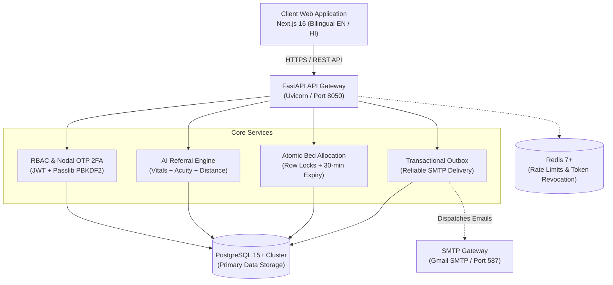
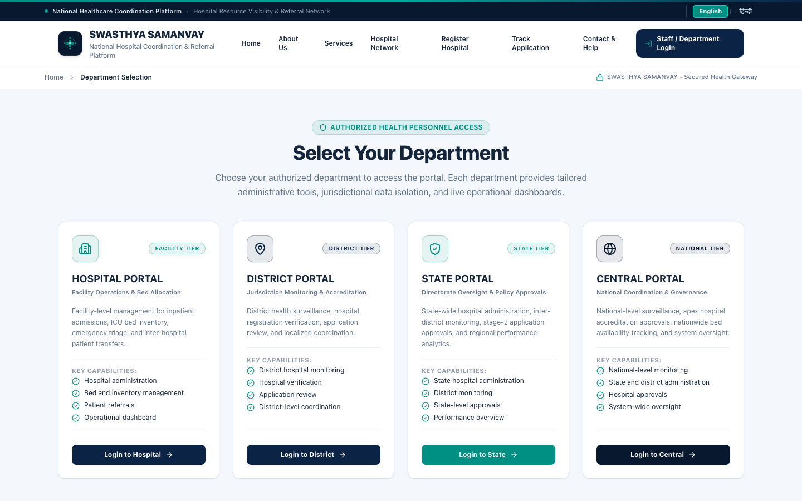

# SWASTHYA SAMANVAY
### AI-Powered Hospital Referral & Bed Management System

<p align="center">
  <strong>Connecting Hospitals. Coordinating Care. Saving Lives.</strong>
</p>

<p align="center">
  
  
  
  
  
</p>

---

## 📌 Project Overview

**SWASTHYA SAMANVAY** is an intelligent clinical coordination and hospital command network designed to eliminate emergency transfer bottlenecks. It connects frontline hospitals, district health authorities, state directorates, and central command into an integrated digital infrastructure.

The platform provides real-time visibility into ICU and general bed capacity, condition-based AI referral recommendations, atomic bed reservations with automatic expiry windows, and an auditable multi-tier regulatory onboarding pipeline for healthcare facilities.

---

## 🎥 Project Walkthrough

Watch a comprehensive demonstration of SWASTHYA SAMANVAY covering facility onboarding, live bed reservation, AI-assisted referral routing, and multi-tier administrative governance:

<!-- Replace VIDEO_URL_HERE with your YouTube, Google Drive, or Loom demo link -->
▶️ **[Watch the Complete System Walkthrough & Demo](VIDEO_URL_HERE)**

---

## ⚡ Key Capabilities

- **Real-Time Bed & ICU Accounting:** Real-time general, oxygen, and ICU bed counters with atomic `SELECT FOR UPDATE` reservations and automated 30-minute lock expiry to eliminate double-booking and phantom availability.
- **Condition-Based AI Referral Routing:** Hybrid clinical scoring engine factoring patient acuity, triage vitals (SpO2, pulse, BP, Glasgow Coma Scale), destination specialty matching, and Haversine geo-distance.
- **End-to-End Referral Lifecycle:** Structured bi-directional transfer tracking with strict state transitions:  
  `PENDING` ➔ `ACCEPTED` ➔ `IN_TRANSIT` ➔ `ARRIVED` ➔ `COMPLETED` (or `REJECTED` / `CANCELLED`).
- **Multi-Tier Hospital Accreditation with Nodal 2FA:** Sequential verification pipeline requiring nodal officer email OTP verification, compliance document validation, and sequential sign-offs across **District ➔ State ➔ Central** administrative jurisdictions.
- **Full Bilingual Interface (`English / हिन्दी`):** Zero-layout-shift real-time language switcher persisting localization across all public portals, registration forms, policy pages, and administrative dashboards.

---

## 🏛️ 4-Tier Administrative Architecture

| Operational Tier | Scope & Primary Responsibilities |
|---|---|
| **Hospital / Facility** | Live bed & ICU inventory management, emergency triage intake, condition-based referral initiation, and ambulance transfer handoffs. |
| **District Health Authority** | District-wide critical care capacity surveillance, Stage-1 hospital onboarding review, and local surge coordination. |
| **State Health Directorate** | Regional capacity oversight, Stage-2 secondary accreditation approval, and inter-district patient transfer balancing. |
| **Central Health Command** | Apex national telemetry, final Stage-3 accreditation sign-off, system-wide compliance audit, and health policy governance. |

---

## 🏗️ System Architecture



---

## 📸 Application Screenshots

Place your screenshots in `docs/screenshots/` with the filenames below to preview the platform:

### 1. Public Portal & Bilingual Home (`English / हिन्दी`)


### 2. Multi-Step Hospital Onboarding & Nodal 2FA


### 3. Hospital Operations & Live Bed/ICU Inventory


### 4. Condition-Based AI Hospital Recommendation


### 5. Bi-Directional Transfer & Ambulance Lifecycle


### 6. Multi-Tier District / State / Central Review Portal


---

## 🛠️ Technology Stack & Repository Structure

| Layer | Technologies |
|---|---|
| **Frontend** | Next.js 16 (App Router), React 19, TypeScript, Tailwind CSS v4, Lucide Icons |
| **Backend** | Python 3.11+, FastAPI, Pydantic v2, Uvicorn |
| **Database & ORM** | PostgreSQL 15+, SQLAlchemy 2.0 (with connection pooling) |
| **Caching & Security** | Redis, PBKDF2-HMAC-SHA256, JWT (python-jose) |
| **Analytics & ML** | scikit-learn, NumPy |
| **Testing & CI** | pytest, Playwright |

```
SIH_Hospital_AI/
├── src/                          # FastAPI backend application
│   ├── api/                      # REST API routes, auth & security middleware
│   ├── database/                 # PostgreSQL schema models, db manager & engine
│   ├── services/                 # Referral engine, bed locks, OTP & email outbox
│   └── workers/                  # Background outbox worker & bed reservation expiry
├── frontend/                     # Next.js 16 full-stack frontend
│   ├── app/                      # App Router pages (bilingual EN/HI, portal, policies)
│   ├── components/               # Hospital, District, State & Central dashboards
│   └── lib/                      # REST API client, i18n context & TypeScript interfaces
├── tests/                        # Backend test suite (427 tests passing)
├── scripts/                      # Seed data generators & health verification utilities
├── docs/                         # Technical documentation & architecture runbooks
│   └── screenshots/              # Application UI screenshot assets (.gitkeep)
├── requirements.txt              # Backend Python dependencies
├── render.yaml                   # Render deployment configuration
└── README.md                     # Project documentation
```

---

## 🚀 Quick Local Setup & Verification

### 1. Backend Setup
```bash
# Clone the repository
git clone https://github.com/codeswith-pawan/SIH-Hospital-AI.git
cd SIH-Hospital-AI

# Create and activate virtual environment
python3 -m venv .venv
source .venv/bin/activate         # Windows: .venv\Scripts\activate

# Install dependencies
pip install -r requirements.txt

# Configure environment variables
cp .env.example .env

# Start FastAPI backend (port 8050)
uvicorn src.api.main:app --reload --port 8050
```

### 2. Frontend Setup
```bash
# In a separate terminal, navigate to frontend/
cd frontend

# Install Node dependencies
npm install

# Start Next.js development server (port 3000)
npm run dev
```

Open **[http://localhost:3000](http://localhost:3000)** in your browser.

### 3. Run Automated Tests
```bash
# Run backend pytest suite (427 tests)
pytest -q

# Run frontend TypeScript typecheck and production build
cd frontend
npx tsc --noEmit
npm run build
```

---

## 🌐 Live Deployments & Support

- **Frontend Application:** [https://arogyasetu-grid.vercel.app](https://arogyasetu-grid.vercel.app) *(Vercel)*
- **Backend API:** [https://arogyasetu-grid-api.onrender.com](https://arogyasetu-grid-api.onrender.com) *(Render)*
- **Interactive API Documentation:** [http://localhost:8050/docs](http://localhost:8050/docs) *(Swagger UI)*
- **Maintainer:** Pawan Kumar ([@codeswith-pawan](https://github.com/codeswith-pawan))
- **Technical Inquiries:** `pawanbussiness108@gmail.com`
