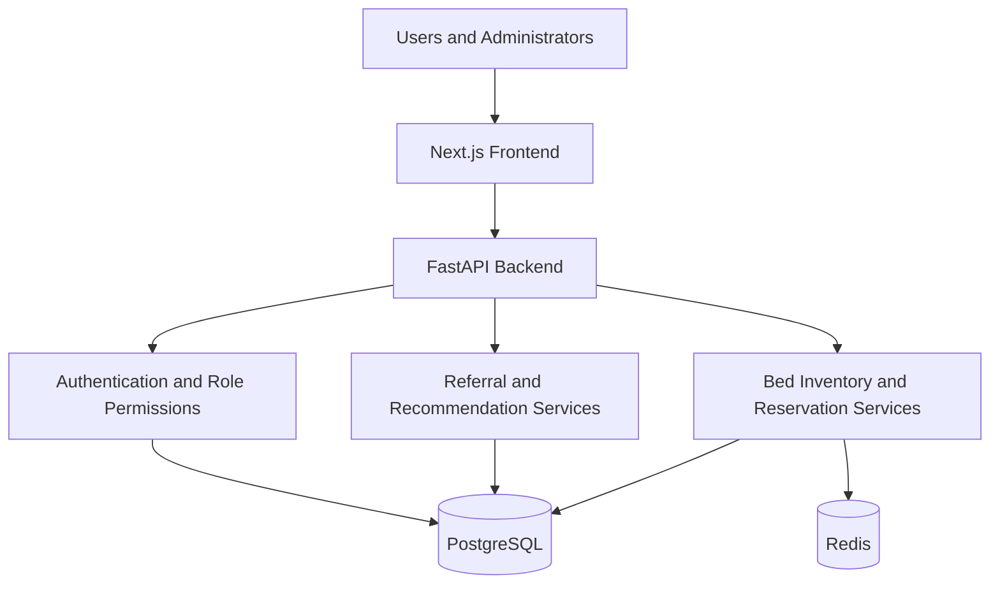

SWASTHYA SAMANVAY
AI-Powered Hospital Referral & Bed Management System

  <strong>Connecting Hospitals. Coordinating Care. Saving Lives.</strong>

  
  
  
  
  

Project Overview
SWASTHYA SAMANVAY is a hospital referral and resource-coordination platform designed to help healthcare facilities coordinate patient referrals and manage hospital bed availability across multiple administrative levels.

The system provides a centralized workflow for viewing facility resources, identifying suitable hospitals, initiating referrals, and reserving beds. It is developed as an independent engineering prototype in the context of the Smart India Hackathon (SIH).

The platform demonstrates how technology can support coordination between hospitals, districts, states, and central-level administrators.
Project status: Prototype / demonstration system. It is not an official Government of India platform and is not currently connected to live hospital or government health databases.

Project Walkthrough
A complete video walkthrough covering the project, modules, user roles, and end-to-end workflows will be added here.

Watch the Project Demo
<!-- Replace ADD_VIDEO_LINK_HERE with your YouTube, Drive, or other video URL. -->Problem Statement
During urgent patient referrals, finding an appropriate hospital with the required resources can be difficult when bed availability and facility information are distributed across different hospitals.

SWASTHYA SAMANVAY aims to demonstrate a coordinated digital workflow that can help:
- Make hospital bed and resource information easier to track.
- Identify suitable facilities for patient referrals.
- Coordinate referrals across administrative levels.
- Reduce duplicate bed allocation through controlled reservations.
- Provide role-based visibility and administrative oversight.
Key Features
- Hospital and bed inventory: Maintain facility-level bed and resource information.
- Patient referral workflow: Create and manage referrals to suitable healthcare facilities.
- Facility recommendation: Rank potential hospitals using available facility and requirement information.
- Atomic bed reservation: Use controlled reservation logic with expiry to reduce conflicting allocations.
- Multi-level administration: Support facility, district, state, and central-level roles.
- Onboarding and accreditation workflow: Support facility onboarding and approval processes.
- Worker management: Provide workflows for managing authorized system workers.
- Monitoring and metrics: Display operational information for system oversight.
Administrative Structure
The platform is organized into four operational levels:
Level	Responsibility
Hospital / Facility	Manage facility details, bed inventory, and referrals
District	Monitor and coordinate facilities within a district
State	Oversee district-level operations and facility coordination
Central	View and monitor the broader network

Access and available operations depend on the user's assigned role and permissions.
How the Referral Workflow Works
1. An authorized user enters the patient's referral requirements.
2. The system evaluates available facility information against those requirements.
3. Potential hospitals are filtered and ranked using the platform's recommendation logic.
4. An appropriate facility can be selected for referral.
5. The bed reservation workflow checks availability and creates a time-limited reservation.
6. The referral and reservation status can be tracked through the system.
The recommendation output is intended as operational decision support. It does not replace clinical judgment or emergency medical protocols.
Recommendation and Reservation Logic
The project uses a combination of eligibility checks and ranking logic to identify potentially suitable facilities.

The workflow considers the information available in the system, such as facility resources, bed availability, and referral requirements. The resulting list is intended to help users compare candidate facilities.

The reservation component uses atomic operations and reservation expiry to reduce the risk of two users allocating the same bed at the same time.
The system is a prototype. Its recommendations should not be treated as validated clinical decisions.

Technology Stack
Layer	Technologies
Frontend	Next.js, React, TypeScript, Tailwind CSS
Backend	Python, FastAPI
Database	PostgreSQL, SQLAlchemy
Caching / Reservation Support	Redis
Recommendation / Data Processing	Python, scikit-learn
API Communication	REST APIs

System Architecture

Screenshots
Screenshots will be added manually.
<!--
Add your screenshots below when ready.

### 1. Dashboard
[Add dashboard screenshot here]

### 2. Hospital / Facility Management
[Add facility management screenshot here]

### 3. Bed Inventory
[Add bed inventory screenshot here]

### 4. Patient Referral
[Add patient referral screenshot here]

### 5. Hospital Recommendation
[Add recommendation result screenshot here]

### 6. Admin Panel
[Add admin panel screenshot here]
-->Local Setup
Prerequisites
Make sure the following are installed:
- Python
- Node.js and npm
- PostgreSQL
- Redis
- Git
1. Clone the repository
git clone https://github.com/codeswith-pawan/SIH-Hospital-AI.git
cd SIH-Hospital-AI
2. Backend setup
Open a terminal in the backend directory:
cd backend
python -m venv venv
Activate the virtual environment.

macOS / Linux
source venv/bin/activate
Windows
venv\Scripts\activate
Install dependencies:
pip install -r requirements.txt
Configure the required environment variables for the database, Redis, and application settings using the environment template provided in the repository.

Start the backend using the run command configured by the project. For a standard FastAPI application, this may be:
uvicorn main:app --reload
If the backend entry-point or module path differs in your checkout, use the command specified in that directory's project configuration.
3. Frontend setup
Open another terminal and move to the frontend directory:
cd frontend
npm install
npm run dev
Open the local URL printed by the frontend development server.
Note: Directory names, environment-variable names, and startup commands should match the current repository configuration. Update this section if your local project structure uses different names.

Testing
The project includes testing for key application workflows and backend functionality.

Before presenting test results, run the current test suite in your environment and update this section with the latest verified results.

Example:
# Run from the backend directory
pytest
Current Scope and Limitations
- The project uses synthetic / sample data for demonstration.
- It is not integrated with live Electronic Health Record (EHR) systems.
- Live ambulance GPS tracking is not integrated.
- It is not a production-hosted national healthcare service.
- Recommendation results are operational suggestions, not clinical decisions.
- Production deployment would require security audits, privacy controls, reliability testing, and integration with authorized healthcare systems.
Future Scope
- Integration with authorized hospital information systems and verified live data.
- Secure interoperability with approved health data platforms.
- Live ambulance and emergency transport coordination.
- Improved analytics and resource-demand forecasting.
- Stronger audit, privacy, and security controls.
- Scalable deployment for larger healthcare networks.
Repository Structure
The project is organized into frontend and backend components, along with supporting configuration and documentation.
SIH-Hospital-AI/
├── backend/       # FastAPI backend and application services
├── frontend/      # Next.js frontend
├── README.md
└── ...
Contributors
Pawan Kumar
GitHub: @codeswith-pawan
Disclaimer
SWASTHYA SAMANVAY is an independent prototype developed for demonstration and project purposes. It is not an official Government of India application, does not represent an official SIH deployment, and must not be used as a substitute for professional medical judgment or emergency services.
