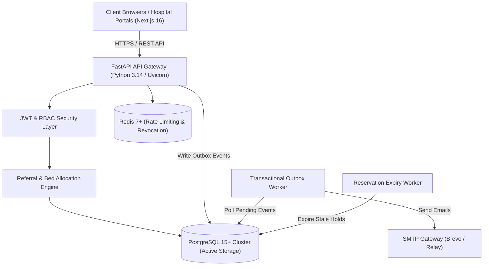
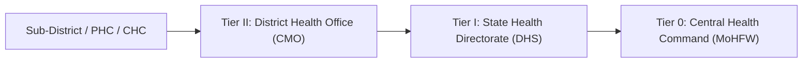
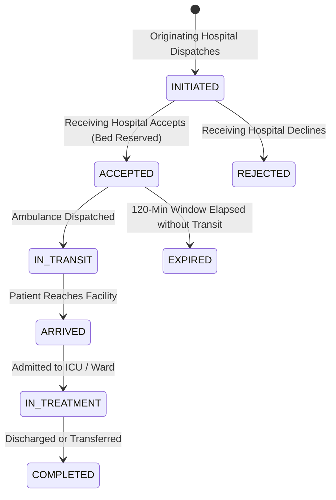

# System Architecture & Technical Design

**Project:** ArogyaSetu Grid — Unified Critical Care & Hospital Command Network (`SIH_Hospital_AI`)  
**Architecture Style:** Modular Monolithic Backend (FastAPI) + Standalone SSR/CSR Frontend (Next.js 16) + Distributed Background Processing (Transactional Outbox)

---

## 1. High-Level System Architecture

ArogyaSetu Grid unites healthcare facilities across local, district, state, and national tiers into an integrated clinical referral and bed management network.

---

## 2. Four-Tier Jurisdictional Governance Hierarchy

The platform implements strict geographic and administrative data isolation across 4 distinct healthcare tiers:

| Tier Level | Role Name | Scope & Authority | Primary Responsibilities |
|:---|:---|:---|:---|
| **Facility Tier** | `HOSPITAL` | Individual accredited hospital | Inpatient bed inventory, triage, patient intake, initiate & accept referrals |
| **District Tier** | `DISTRICT_ADMIN` | District jurisdiction (e.g. Amritsar, Patna) | Local hospital capacity surveillance, Stage-1 registration dossier inspection |
| **State Tier** | `STATE_ADMIN` | State jurisdiction (e.g. Punjab, Bihar) | Regional logistics, interstate transfers, Stage-2 registration dossier approval |
| **National Tier** | `CENTRAL_ADMIN` | Nationwide command | Apex facility approvals, nationwide bed availability, system oversight |

---

## 3. Core Operational Engines

### 3.1 Smart Patient Intake & Geo-Proximity Referral Engine
The referral recommendation engine evaluates prospective receiving facilities using a multi-factor hybrid scoring model:
1. **Clinical Eligibility Gating:** Requires confirmed ICU/ventilator availability matching the patient's triage severity (CRITICAL, SEVERE, MODERATE).
2. **Specialty Alignment:** Matches required clinical department (Cardiology, Neurology, Trauma Surgery, Pediatrics) against verified hospital capabilities.
3. **Geographic Proximity Ranking:** Computes great-circle distance via the Haversine formula, prioritizing same-district, adjacent-district, and same-state facilities over distant out-of-state hospitals.
4. **Acceptance Probability Scoring:** Utilizes historical referral acceptance rates and live occupancy ratios.

### 3.2 Atomic Bed Reservation & Lifecycle State Machine
To prevent phantom availability and double-booking races during mass casualty incidents:
- Acceptance of a referral atomically reserves a bed via PostgreSQL row locks (`SELECT ... FOR UPDATE`).
- The bed transitions through strict operational states:

---

## 4. Background Workers & Transactional Outbox

To guarantee email delivery without blocking interactive HTTP request threads, the system employs the **Transactional Outbox Pattern**:
- Email notifications are written to the `email_outbox` table in the same database transaction as the business event.
- An autonomous daemon (`src/workers/outbox_worker.py`) polls pending rows using row leases (`locked_at`), delivers messages via SMTP, and records audit results with exponential backoff retries.
- A secondary daemon (`src/workers/reservation_expiry_worker.py`) periodically identifies unfulfilled bed reservations exceeding operational TTLs and safely releases held capacity.
