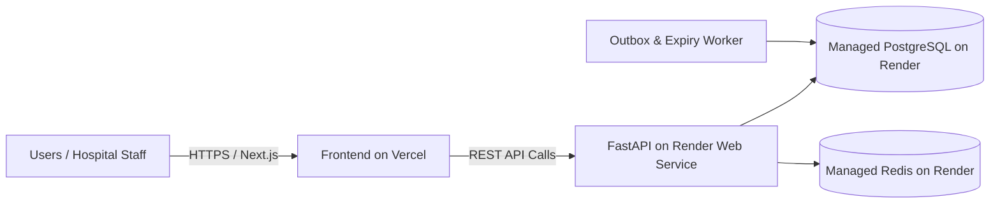

# Production Deployment Guide

**Project:** ArogyaSetu Grid — Unified Critical Care & Hospital Command Network (`SIH_Hospital_AI`)

This document outlines deployment architectures for hosting ArogyaSetu Grid on cloud platforms (Render + Vercel) or on containerized Linux servers (Docker Compose).

---

## 1. Cloud Architecture (Render + Vercel)

The recommended modern hosting pattern:
- **Backend API & PostgreSQL:** Deployed on **Render** using `render.yaml`.
- **Frontend Portal:** Deployed on **Vercel** with Next.js App Router optimizations.



### 1.1 Render Backend Deployment (`render.yaml`)
The repository includes a ready-to-use Render Blueprint (`render.yaml`):

```yaml
services:
  - type: web
    name: arogyasetu-grid-api
    runtime: python
    buildCommand: "pip install -r requirements.txt"
    startCommand: "uvicorn src.api.main:app --host 0.0.0.0 --port $PORT"
    envVars:
      - key: ENVIRONMENT
        value: production
      - key: DATABASE_URL
        fromDatabase:
          name: arogyasetu-db
          property: connectionString
      - key: PORTAL_BASE_URL
        value: https://arogyasetu-grid.vercel.app
```

### 1.2 Vercel Frontend Deployment
1. Connect the GitHub repository to Vercel.
2. Set **Root Directory** to `frontend`.
3. Set Environment Variables:
   - `NEXT_PUBLIC_API_BASE_URL=https://arogyasetu-grid-api.onrender.com`
   - `NEXT_PUBLIC_API_URL=https://arogyasetu-grid-api.onrender.com`
4. Deploy.

---

## 2. Containerized Deployment via Docker Compose

For on-premise hospital data centers or private cloud VPS instances:

```bash
# 1. Prepare environment configuration
cp .env.production.example .env.production
chmod 600 .env.production

# 2. Build and launch all services in detached mode
docker compose -f docker-compose.prod.yml up -d --build

# 3. Check health status
docker compose -f docker-compose.prod.yml ps
curl http://localhost:8000/health/ready
```

**Services Orchestrated:**
- `postgres`: PostgreSQL 15+ container with persistent volume.
- `redis`: Redis 7+ cache & rate limiter.
- `backend`: FastAPI API server running on isolated bridge network.
- `outbox_worker`: Background transactional email delivery worker.
- `reservation_expiry_worker`: Automatic bed reservation release worker.
- `frontend`: Standalone Next.js production frontend.
